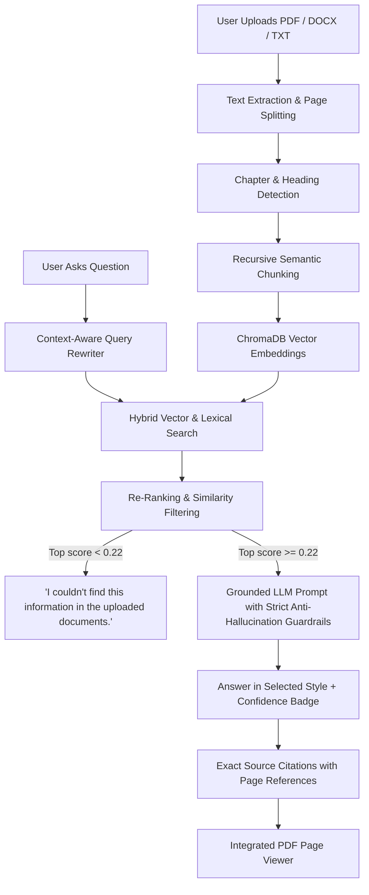

# DocuMind AI — Intelligent Multi-Document Question Answering System

[](https://www.python.org/downloads/)
[](https://fastapi.tiangolo.com)
[](https://www.trychroma.com/)
[](https://opensource.org/licenses/MIT)

**DocuMind AI** is an end-to-end, production-grade document intelligence and question answering application. Users can upload multiple books, research papers, reports, or lecture notes (PDF, DOCX, TXT, MD) simultaneously, interrogate them with natural language questions, and receive strictly grounded answers with exact document page citations and relevance scores.

---

## 🌟 Key Features

### 1. Document Management & Multi-File Processing
- **Multi-File Upload**: Upload multiple books/documents at once via drag-and-drop or file picker.
- **Broad File Format Support**: Native parsing for **PDF** (via PyMuPDF), **DOCX** (via python-docx), **TXT**, and **Markdown**.
- **Automated Text Extraction & Deduplication**: Fast SHA-256 content hashing to avoid redundant re-processing of already indexed files.
- **Scanned PDF Detection**: Automatically detects image-based/scanned pages and warns the user when OCR is required.
- **Document Library**: View page counts, semantic chunk counts, formatted file sizes, and processing statuses. Search documents by title in real-time.
- **Multi-Document Selection**: Select all documents or check specific books to restrict the search space.

### 2. Semantic RAG (Retrieval-Augmented Generation) Pipeline
- **Smart Chunking**: Splits documents into contextual chunks with sliding overlaps, retaining document ID, filename, page number, and chapter title.
- **High-Dimensional Embeddings**: Powered by ChromaDB's local ONNX MiniLM engine (100% offline-capable, zero external API key required for embeddings).
- **Hybrid Retrieval**: Combines dense vector cosine similarity with BM25/keyword lexical matching to boost specific terms, entity names, and formulas.
- **Top-K Re-ranking**: Evaluates retrieved chunks, sorts by combined relevance score, and calculates confidence ratings (**High**, **Medium**, **Low**).
- **Strict Anti-Hallucination Guardrails**: The system will **only** answer based on uploaded document content. If information is absent, it responds:
  > *"I couldn't find this information in the uploaded documents."*

### 3. Answer Style Selector (8 Formats)
The selected style directly shapes the AI prompt and synthesis:
1. **Concise**: Direct 1–2 sentence answer focusing purely on core facts.
2. **Detailed**: Comprehensive, in-depth explanation with headers and supporting evidence.
3. **Bullet Points**: Clean bulleted list with bold key terms.
4. **Summary**: Executive overview synthesizing primary conclusions.
5. **Simple Explanation**: Beginner-friendly explanation avoiding dense jargon.
6. **Exam Answer**: Academic structured response (Definition, Core Principles, Evidence, Conclusion).
7. **Step-by-Step**: Sequential numbered procedure or walkthrough.
8. **Key Points**: Critical takeaways and core definitions.

### 4. Chapter Detection & Chapter-Specific Querying
- Automatically extracts table of contents (TOC) from PDFs or scans headers using regex patterns.
- Displays chapter navigation accordions in the Document Library.
- Allows targeted queries or summaries within a specific chapter.

### 5. Source Citations & Integrated Document Viewer
- Every response displays clickable citation chips showing `[📄 filename.pdf - Page 4 (88% match)]`.
- Right-hand inspector reveals full retrieved excerpts for instant verification.
- **Built-in Document Viewer**: Clicking a source citation renders the exact PDF page image with zoom, previous/next, and jump-to-page controls.

### 6. Document Summarizer
Dedicated document summarization tool offering:
- Short Executive Summary
- Detailed Summary
- Key Points & Takeaways
- Important Conceptual Frameworks
- Important Definitions & Terms
- Chapter-by-Chapter Breakdown
- Scope: Summarize **Entire Book** or a **Specific Chapter**.

### 7. Interactive Multiple-Choice Quiz Generator
- Generate interactive quizzes directly from any uploaded book or chapter.
- Configurable number of questions (3, 5, 8) and difficulty level (Easy, Medium, Hard).
- Instant interactive feedback: option buttons highlight Green for correct and Red for incorrect.
- Detailed explanation box citing the exact document page reference.
- End-of-quiz score summary with percentage and retake option.

### 8. 3D Study Flashcards
- Extract high-yield study flashcards with concepts, definitions, and key formulas.
- Interactive 3D flip card animation with smooth perspective rotation.
- Front: Concept / Question with category badge.
- Back: Grounded Definition / Explanation with source page citation.
- Navigation controls: Previous, Next, Flip, Shuffle, and "Mark Learned" mastery tracker.

### 9. Voice Features
- **Voice Input (Speech-to-Text)**: Microphone button using the browser Web Speech API for voice dictation.
- **Read Aloud (Text-to-Speech)**: Integrated browser speech synthesis to read answers aloud with play/pause/stop controls.

### 8. Conversation History & Dashboard
- Persistent SQLite storage for conversations and messages.
- Create new chats, rename chats, delete chats, clear chats, and switch between past conversations.
- Dashboard with real-time statistics: Documents uploaded, pages processed, semantic chunks indexed, and questions asked.
- Automatically generated suggested questions tailored to uploaded documents.

### 9. Multi-Provider AI Engine & Offline Fallback
- Supports **Google Gemini** (`gemini-2.5-flash`), **OpenAI** (`gpt-4o-mini`), and **Groq** (`llama-3.3-70b-versatile`).
- **Built-in Local Grounded Extractor**: Works out-of-the-box in local offline mode even before configuring any external API key!
- Live in-app Settings modal with connection test ping.

---

## 🏗️ Technology Stack

| Layer | Technology |
|---|---|
| **Backend Framework** | FastAPI (Asynchronous Python 3.10+) |
| **Server** | Uvicorn (ASGI) |
| **PDF Engine** | PyMuPDF (Fitz) — High-speed text extraction & page rendering |
| **DOCX Engine** | python-docx |
| **Vector Store** | ChromaDB (Persistent vector database with cosine indexing) |
| **Embeddings** | ONNX MiniLM (chromadb default local embedding function) |
| **Database** | SQLite3 with WAL mode for high-concurrency metadata & history |
| **Frontend UI** | HTML5, Vanilla Modern CSS (Glassmorphism, Dark/Light modes), JavaScript (ES6 Modules) |
| **Speech APIs** | Web Speech API (`SpeechRecognition` & `SpeechSynthesis`) |

---

## 📁 Project Structure

```
AWS question answering system/
├── app.py                      # FastAPI application, REST endpoints, static mounting
├── config.py                   # Central settings, paths, environment variables
├── requirements.txt            # Python dependencies
├── test_app.py                 # Automated end-to-end test suite
├── create_sample_docs.py       # Helper script generating sample PDF and DOCX files
├── README.md                   # Complete documentation
│
├── services/
│   ├── __init__.py
│   ├── document_processor.py   # Multi-format parser, chapter detection, PDF page rendering
│   ├── embeddings.py           # Embedding service (local ONNX MiniLM)
│   ├── vector_store.py         # ChromaDB indexing, hybrid search, filtering
│   ├── rag_engine.py           # Query rewriting, hybrid retrieval, grounding, answer styles
│   └── summarizer.py           # Multi-style document & chapter summarizer
│
├── database/
│   ├── __init__.py
│   └── database.py             # SQLite persistence (documents, chats, messages, settings)
│
├── utils/
│   ├── __init__.py
│   └── helpers.py              # File hashing, sanitization, byte formatting, text cleaning
│
├── static/
│   ├── index.html              # Main single-page web app
│   ├── css/
│   │   └── style.css           # Glassmorphism, 3-panel responsive layout, dark/light themes
│   └── js/
│       ├── api.js              # REST API client
│       ├── chat.js             # Chat controller, Markdown parser, Speech recognition/synthesis
│       ├── pdf_viewer.js       # Integrated PDF viewer with zoom & page navigation
│       └── app.js              # Master state management, event listeners, UI coordinator
│
├── data/
│   ├── app.db                  # SQLite database file
│   ├── uploads/                # Physical document files
│   └── vector_store/           # ChromaDB persistent vector index
│
└── sample_documents/           # Sample test books (AI & ML Handbook, AWS Cloud Essentials)
```

---

## 🚀 Installation & Setup (Windows PowerShell)

### Step 1: Open PowerShell and Navigate to Workspace
```powershell
cd "c:\Users\ELCOT\Desktop\AWS question answering system"
```

### Step 2: (Optional) Create and Activate Virtual Environment
```powershell
python -m venv venv
.\venv\Scripts\Activate.ps1
```

### Step 3: Install Required Dependencies
```powershell
pip install -r requirements.txt
```

---

## 🔑 AI API Key Configuration

The application is fully functional **without** an API key using the built-in **Local Grounded Extractive Synthesizer**.

To enable generative LLM capabilities with Google Gemini, OpenAI, or Groq, choose one of the following methods:

### Method A: Configure in the Web UI (Recommended)
1. Launch the web application.
2. Click **⚙️ Settings** in the bottom-left sidebar.
3. Select your provider (**Google Gemini**, **OpenAI**, or **Groq**).
4. Enter your API Key and click **🧪 Test Connection**.
5. Click **Save Configuration**.

### Method B: Environment Variables / PowerShell
```powershell
$env:GEMINI_API_KEY="your-gemini-api-key-here"
# or
$env:OPENAI_API_KEY="your-openai-api-key-here"
# or
$env:GROQ_API_KEY="your-groq-api-key-here"
```

---

## ▶️ How to Run the Application

Start the FastAPI application with Uvicorn:

```powershell
python -m uvicorn app:app --host 127.0.0.1 --port 8000 --reload
```

Open your web browser and navigate to:
```
http://127.0.0.1:8000
```

---

## 🧪 Running the Automated Test Suite

A comprehensive test suite is included to verify all 14 pipeline stages:

```powershell
python test_app.py
```

### Test Coverage:
1. `test_startup_and_stats`: Verifies database initialization and dashboard stats endpoint.
2. `test_document_processor_pdf`: Validates PDF page extraction, chapter detection, and page rendering.
3. `test_document_processor_docx`: Validates DOCX heading and chapter parsing.
4. `test_vector_store_and_search`: Validates chunking, embedding generation, and hybrid vector search.
5. `test_rag_answering_and_grounding`: Validates grounded answers, page citations, and answer styles.
6. `test_anti_hallucination_rule`: Verifies rejection of queries on non-existent information.
7. `test_followup_question_query_rewriting`: Verifies contextual rewrite of follow-up questions.
8. `test_summarization_service`: Validates document summarization (key points, definitions).
9. `test_api_upload_and_chat_flow`: Validates end-to-end FastAPI endpoints, upload, chat, and deletion.

---

## 🧠 How the RAG Pipeline Works



1. **Ingestion & Extraction**: Documents are parsed page-by-page using PyMuPDF or python-docx. Scanned documents are checked for text density.
2. **Chapter Detection**: Native outlines/TOCs or regex headings identify start and end page boundaries for each chapter.
3. **Chunking**: Text is split into ~750 character chunks with 150 character overlaps, tagged with page numbers, document IDs, and chapter names.
4. **Vector Storage**: Embeddings are stored persistently in ChromaDB with cosine distance indexing.
5. **Query Rewriting**: If a user asks a follow-up question (e.g., *"Give an example"*), the system merges recent chat context into a standalone query.
6. **Hybrid Retrieval**: Fetches top vector candidates and boosts chunks having exact lexical match with query terms.
7. **Grounding & Generation**: The LLM is provided only with the retrieved excerpts and instructed to answer strictly based on those facts, citing the exact document name and page. If no relevant chunks meet the similarity threshold, hallucination is prevented.

---

## 🛠️ Troubleshooting

- **Port 8000 already in use**:
  Run on a different port:
  ```powershell
  python -m uvicorn app:app --host 127.0.0.1 --port 8080
  ```
- **Scanned PDF warning**:
  If a PDF contains scanned images of pages rather than digital text, DocuMind will highlight it with a warning badge. Use searchable digital PDFs for optimal extraction.
- **Resetting Database & Vector Store**:
  Delete the `data/` folder and restart the app to start with a fresh environment:
  ```powershell
  Remove-Item -Recurse -Force data\
  ```

---

## 📜 License
DocuMind AI is open-source software licensed under the MIT License.
# AWS-AI-Powered-Question-Answering-System

